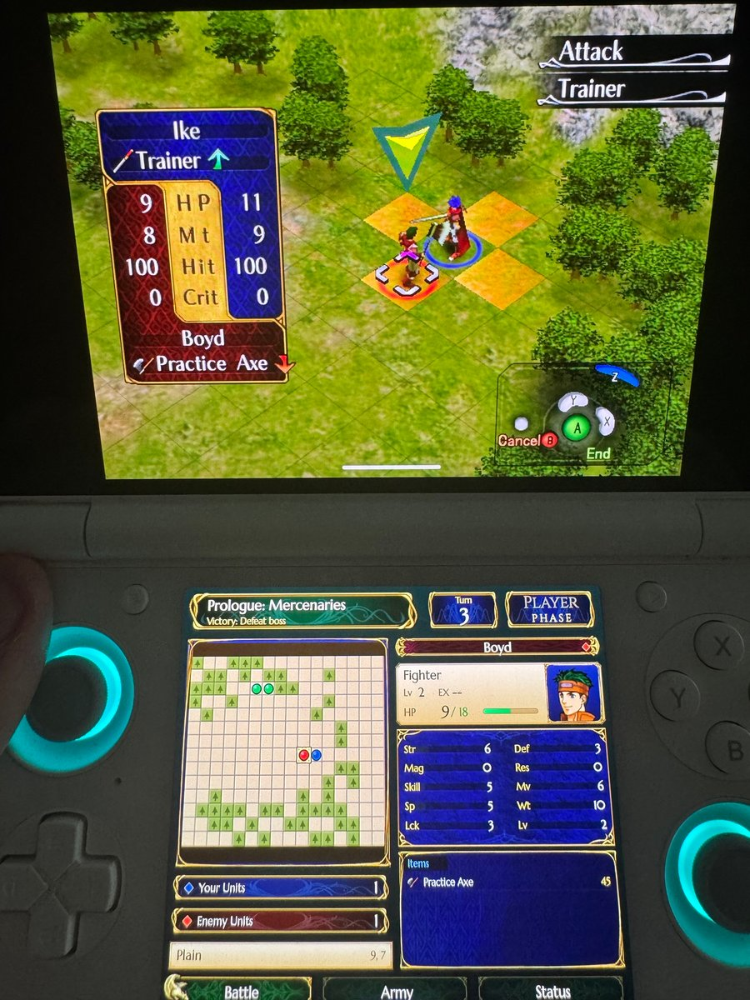

# Dolphin Duo

**Dolphin Duo** is a fork of the [Dolphin](https://dolphin-emu.org/) GameCube and Wii emulator for
dual-screen Android handhelds like the **AYN Thor**. The game runs on the top screen as usual. The
bottom screen shows a live, touchable **companion** for the game you're playing: maps, unit and
party stats, inventories, scene views.

<!-- Thor photo: game on the top screen, Path of Radiance companion on the bottom.
<p align="center"></p>
-->

Dolphin Duo is **not affiliated with or endorsed by the Dolphin project**. Please report Duo
problems [here](https://github.com/CMApex/dolphin-duo/issues), not to Dolphin's issue tracker.

> **Status: early and moving fast.** The builds below are debug test builds. Expect rough edges.

## Download

Test builds are on the [Releases page](https://github.com/CMApex/dolphin-duo/releases). Each
branch publishes its newest build as a pre-release named `duo-latest-<branch>`:
`duo-latest-master` is the main line, and the others carry work in progress.

* The APK is arm64 and installs as **Dolphin Duo Debug**, alongside regular Dolphin rather than
  replacing it.
* Every test build is signed with the same key, so newer builds install over older ones and keep
  your settings and companions.

## Devices

* **AYN Thor**: the device Dolphin Duo is built and laid out for (1240x1080 bottom screen).
* **Other Android devices with a second display**: should work. Dolphin Duo uses any Android
  *presentation* display other than the one the game is on. Companions can also provide a 4:3
  layout.
* **Single-screen phones and desktop**: behave like normal Dolphin. The companion runtime only
  runs while a second screen is attached.

## Companions

A companion is a small declarative package (a `manifest.json` plus optional fonts and images)
written for one game. It reads the game's memory between frames and draws pages on the second
screen. Companions can only change memory or press buttons if they ask for it, and the installer
shows you which ones do before you install.

Tap a game's name to download its companion (the newest build from `master`).

| Game | ID | What it shows | |
|---|---|---|---|
| [Fire Emblem: Path of Radiance](https://github.com/CMApex/dolphin-duo/releases/download/duo-latest-master/fe9-path-of-radiance.zip) | `GFEE01` | Live war-map minimap, unit under the cursor, army roster, full status, battle and scene views, in the game's own style | [Details](Companions/fe9-path-of-radiance/README.md) |

**Your disc, your assets.** Companions don't ship any of the game's art or text. Things like
portraits, item icons, window frames, and character and item names are read from **your own disc
image** while you play. Nothing from the games lives in this repository.

### Installing a companion

1. Download the companion's zip from the table above. Every test build on the
   [Releases page](https://github.com/CMApex/dolphin-duo/releases) also carries the companions
   from the same commit, so a branch's APK and its companions always match.
2. In Dolphin Duo, open **Settings → Interface → Dolphin Duo → Manage Companions** and install the
   zip.
3. Start the game. The companion appears on the second screen.

Working on a companion yourself? Zip its folder (with `manifest.json` at the top) and install that
instead.

With no companion installed for a game, the second screen shows the **Inspector**: the game ID,
the revision and a live view of any addresses you list in `Duo/Watches/<GAMEID>.txt`.

The same settings section can turn the companion screen off and controls whether companions may
change game memory. Memory changes are always blocked in RetroAchievements hardcore mode.

## Making companions

Start with [docs/DolphinDuo](docs/DolphinDuo/README.md), which covers how it works and the
workflow from finding addresses to installing.

* [PACKAGE_FORMAT.md](docs/DolphinDuo/PACKAGE_FORMAT.md): the manifest reference (values, pointer
  chains, arrays, expressions, pages, canvas pages, `disc:` images and text tables, actions).
* [examples/template](docs/DolphinDuo/examples/template/manifest.json): a starter companion, plus a
  script that writes a fake memory dump to preview it with.
* `dolphin-tool duo validate | preview`: check a companion and render its pages from a memory dump
  on desktop.
* [Tools/DolphinDuo/preview](Tools/DolphinDuo/preview): a desktop renderer for canvas pages.
* [Tools/DolphinDuo/headless](Tools/DolphinDuo/headless): plays a game from a script in headless
  Dolphin, dumping memory and screenshots and running the companion runtime along the way.

Your companion's own images and fonts have to be yours or freely licensed. Anything from the game
should come from the player's disc through `disc:` references.

## Building

Dolphin Duo builds the same way as Dolphin. See Dolphin's
[README](docs/UPSTREAM_README.md#building) and [AndroidSetup.md](AndroidSetup.md). Clone with
submodules, then build the Android APK:

```sh
cd Source/Android
./gradlew assembleDebug -PduoAbis=arm64-v8a
```

* `-PduoAbis` limits the build to the listed ABIs, which saves a lot of build time. Don't use
  Android Studio's ABI shortcut (`android.injected.build.abi`) for APKs you plan to share: it marks
  them test-only, so they won't install from a file manager.
* Debug builds are signed with `Source/Android/duo-debug.keystore`, a public test key that keeps
  test builds installing over each other. **Never** sign a real release with it.
* [`.github/workflows/duo-android.yml`](.github/workflows/duo-android.yml) builds the APK on every
  push to `master` and `dolphin-duo/**` and publishes the pre-releases.

Desktop builds include `dolphin-tool duo` and the headless harness (`dolphin-emu-nogui`). Unit
tests for the runtime are in `Source/UnitTests/Core/DuoTest.cpp`.

## Credits and license

* **Dolphin** is the work of the [Dolphin team](https://github.com/dolphin-emu/dolphin) and its
  contributors. Dolphin Duo is just a layer on top. Dolphin's own README is kept at
  [docs/UPSTREAM_README.md](docs/UPSTREAM_README.md).
* Inspired by [Eden Duo](https://github.com/igawa6/eden-duo), which brings second-screen companions
  to Switch emulation on the same handhelds. Dolphin Duo's code is written from scratch.
* Licensed like Dolphin, under the **GNU General Public License, version 2 or later** (GPLv2+). See
  [COPYING](COPYING) and [LICENSES](LICENSES).
* Path of Radiance's companion uses the [Marcellus](https://fonts.google.com/specimen/Marcellus) and
  [Cinzel](https://fonts.google.com/specimen/Cinzel) fonts (SIL Open Font License).
